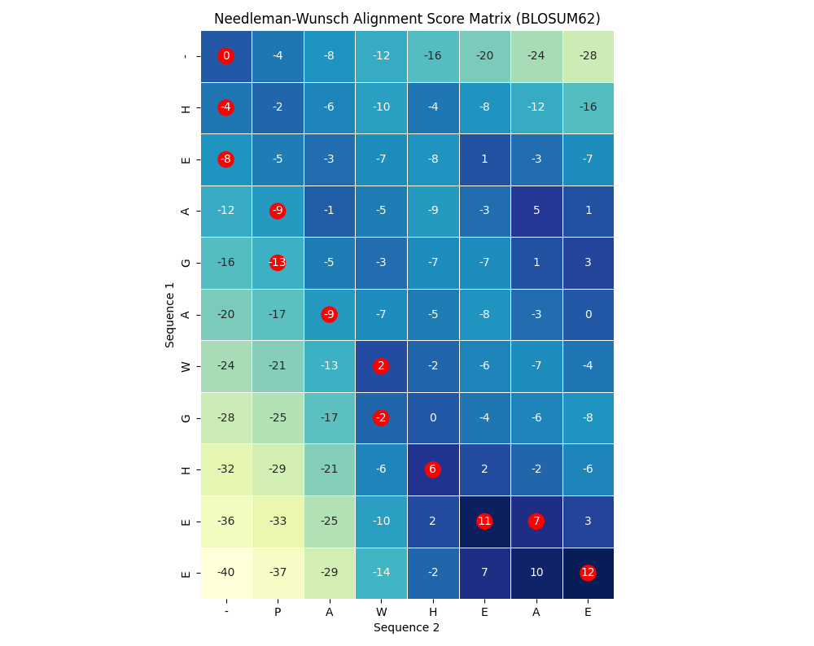

# 🧬 Needleman-Wunsch Aligner with BLOSUM62 + Heatmap


A Python-based global sequence alignment tool implementing the **Needleman-Wunsch algorithm** with **BLOSUM62 scoring** and a **heatmap visualization** of the dynamic programming matrix using `seaborn`.

---

## 📌 Features

- Global alignment using Needleman-Wunsch algorithm
- Customizable **gap penalty**
- Uses **BLOSUM62** matrix via Biopython
- Visualizes the scoring matrix as a **color-coded heatmap**
- Highlights the **traceback path** (optimal alignment route)
- Displays aligned sequences with match indicators (`|`)
- Export heatmap as `.png`
- Supports **FASTA-style output**
- Simple interactive prompts — no CLI required

---

## 🚀 Project Structure

```
Needleman-Wunsch-Aligner/
├── Aligner.py              # Needleman-Wunsch alignment with BLOSUM62 scoring
├── alignment.fasta         # Example aligned output
├── alignment_heatmap.png   # Example scoring-matrix heatmap with traceback path
├── README.md
└── LICENSE
```
---

## 🧪 Sample Input/Output

### Example Input
```
Enter name for first sequence: Seq 1
Enter first sequence: HEAGAWGHEE
Enter name for second sequence: Seq 2
Enter second sequence: PAWHEAE
```

### Example Output
```
Final Alignment Score: 12

Aligned Sequences:
Seq1: HEAGAWGHE-E
      ----||-||-|
Seq2: --P-AW-HEAE

✅ Alignment saved to alignment.fasta
```
### Heatmap Output

<p align="center">
  
</p>

---

## 🧰 Dependencies

Make sure you have Python 3.7+ installed.

Install required libraries:

```bash
pip3 install biopython pandas seaborn matplotlib

```
---

## 📦 How to Use
1. Clone this repository:

```bash
git clone https://github.com/Arun0364/Needleman-Wunsch-Aligner.git
cd Needleman-Wunsch-Aligner

```
2. Run the program:

```bash
python3 Aligner.py

```
3. Follow on-screen input prompts.

4. A PNG heatmap of the alignment matrix will be saved as alignment_heatmap.png in the same directory.

---

## 📄 Output Format

+ Text alignment with match bars: Prints aligned sequences side-by-side with | for matches.

+ Heatmap PNG: Visual depiction of score matrix.

+ Optional (Advanced): Easily export aligned output in FASTA-style formatting.

---

## 🧠 How it Works

* Initializes a dynamic programming matrix using NumPy.

* Fills scores using BLOSUM62 substitution matrix.

* Traces the optimal alignment path using standard traceback rules.

* Constructs two aligned sequences with insertions (-) where needed.

* Highlights the traceback path on the heatmap with red circles.

---

## 🏷️ Tags

`Bioinformatics` `Python` `NeedlemanWunsch` `GlobalAlignment` `BLOSUM62` `Heatmap` `SequenceAlignment` `FASTA`

---

## 👤 Contact

Arunannamalai Sujatha Bharath Raj

📧 [arun03bt@gmail.com]

🔗 🔗 [linkedin.com/in/arun-sujatha](https://www.linkedin.com/in/arun-sujatha)

🐙 [https://github.com/Arun0364](https://github.com/Arun0364)

---

## 📄 License

This project is licensed under the MIT License — see the [LICENSE](LICENSE) file for details.

---

## ❤️ Acknowledgements

Biopython for substitution matrices

Seaborn & Matplotlib for heatmaps

Classic Needleman-Wunsch algorithm (1970)


